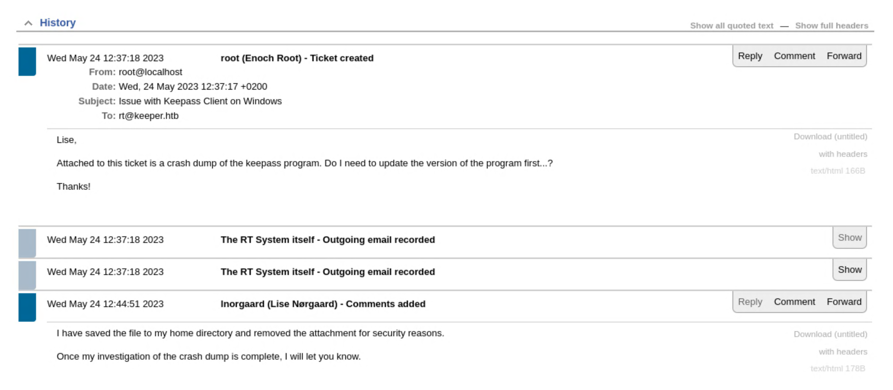
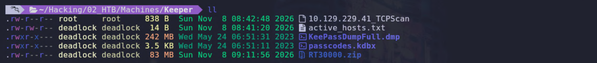
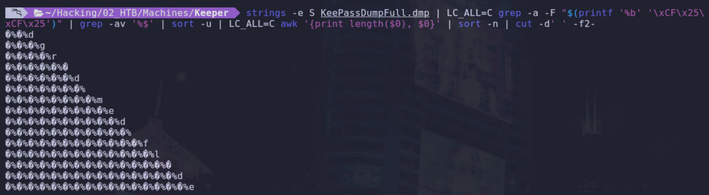
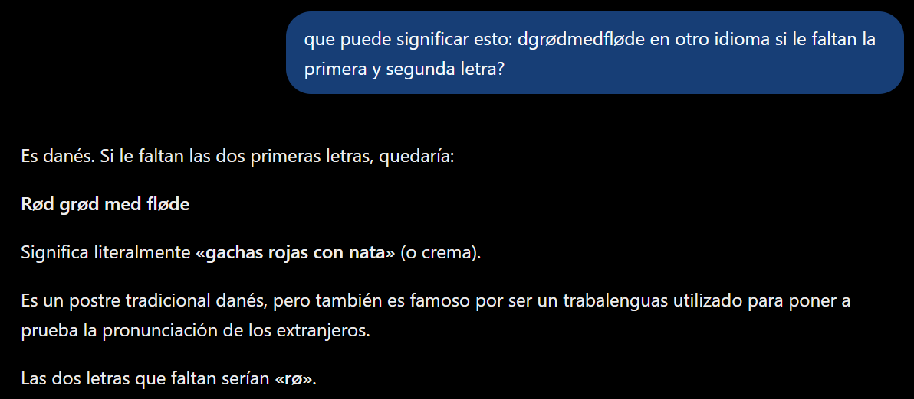
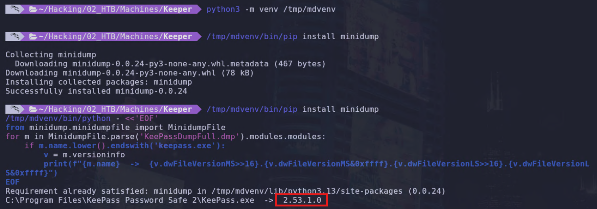
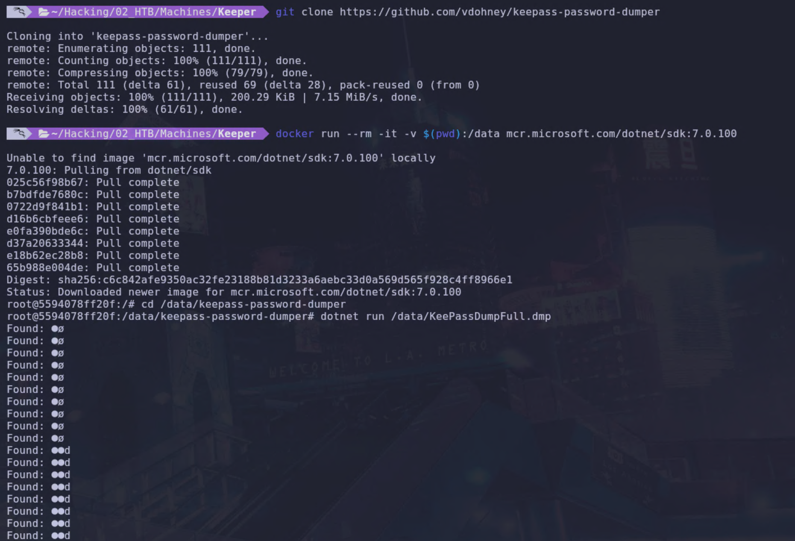
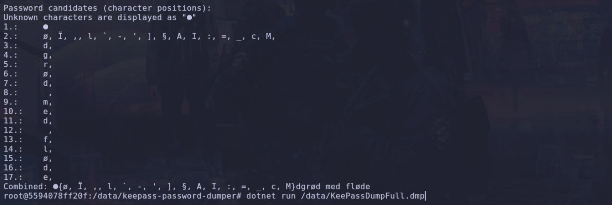
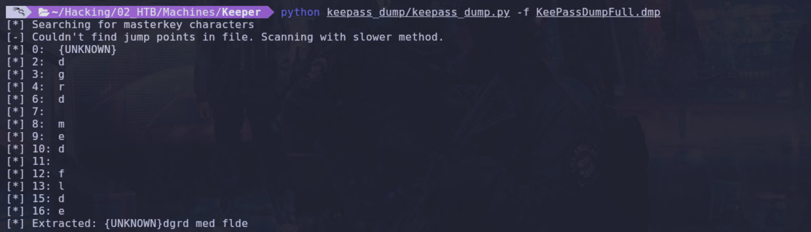

El otro día, resolviendo la máquina Keeper de Hack The Box, me topé con esta fantasía de 2023, y con tan solo tres años de retraso voy a postear sobre ella.



Esta imagen que os he puesto arriba viene de un ticket de la típica plataforma de resolución de incidentes con la que me crucé dentro del ejercicio, y de ahí sale toda la movida. El caso es que un usuario había abierto una incidencia por un fallo del cliente de KeePass en Windows y cuenta que adjunta un crash dump del programa, una copia de la memoria del proceso en el instante en que reventó. Alguien que atiende el ticket contesta que ha guardado el fichero y ha quitado el adjunto por seguridad.

Bueno, pues el caso es que detrás de toda esta movida está una vulnerabilidad del archiconocido gestor de contraseñas KeePass, que ese año repetía, esta vez con la **CVE-2023-32784** (comúnmente conocida como *KeePass Dumper*). La historia trae cola y un poco de salseo.

En mayo de 2023, [vdohney](https://github.com/vdohney) publicaba en GitHub [KeePass 2.X Master Password Dumper](https://github.com/vdohney/keepass-password-dumper), una prueba de concepto con la que recuperaba la contraseña maestra de KeePass en claro, menos el primer carácter. Su prueba se hacía con el workspace bloqueado e incluso con el programa cerrado. Esto se llevó al [foro del proyecto en SourceForge](https://sourceforge.net/p/keepass/discussion/329220/thread/f3438e6283/), y **Dominik Reichl**, el autor de KeePass, lo confirmó allí mismo. La [CVE-2023-32784](https://nvd.nist.gov/vuln/detail/CVE-2023-32784) entró en NVD, la base de datos de vulnerabilidades del NIST estadounidense, el 15 de mayo de 2023, con un 7.5 sobre 10 en CVSS 3.1, la escala con la que se puntúa su gravedad. KeePass venía de un revés a principio de año, cuando ya había caído la [CVE-2023-24055](https://nvd.nist.gov/vuln/detail/CVE-2023-24055), donde quien tuviera escritura sobre el XML de configuración podía colar un **trigger**, una acción que KeePass dispara sola ante ciertos eventos, para exportar las contraseñas en claro a donde le diera la gana.

El proyecto no lo llevó bien y lo discutió, hasta el punto de que NVD lo marca como ***DISPUTED***, con el autor diciendo que la base no está hecha para aguantar a quien ya controla tu equipo. Dos “problemillas” en cuatro meses. Con el de los triggers la respuesta fue *“que el problema es tuyo por dejar entrar a alguien”*. Con este, lo primero que contestó Reichl en el foro fue que seguramente habías desactivado los asteriscos y tenías la contraseña a la vista. Al día siguiente lo dio por bueno, y en menos de una semana ya tenía el arreglo.


Memes aparte, podemos debatir largo y tendido el tema de la responsabilidad, pero bueno.

La cosa es que el NIST cataloga la **CVE-2023-32784** como `CWE-319`, que en el catálogo CWE de tipos de fallo es *Cleartext Transmission of Sensitive Information*, transmisión en claro de información sensible, con el `7.5` de CVSS que ya he dicho. La etiqueta habla de transmisión, cuando esto va de una contraseña que se queda parada en la memoria del proceso. Ese “en claro” de la clasificación sale de cómo KeePass pinta la maestra según la tecleas.

KeePass tapa la contraseña con puntos mientras la escribes, para que nadie te enganche con un *shoulder surfing*, que es mirarte la pantalla por encima del hombro. El fallo está en cómo `SecureTextBoxEx`, su textbox propia, arma esa cadena de puntos en cada pulsación. En el momento en que aprietas una letra, la caja la enseña un instante en claro antes de taparla con su `●`, mientras que las anteriores ya van enmascaradas. Cada tecla deja por tanto un rastro en memoria con todo lo previo en puntos y el carácter nuevo al final. Si la maestra fuera `Patata`, irías viendo esto:

```
P        ->  (nada aprovechable)
Pa       ->  ●a
Pat      ->  ●●t
Pata     ->  ●●●a
Patat    ->  ●●●●t
Patata   ->  ●●●●●a
```

El número de puntos de cada rastro canta la posición. `●●t` lleva dos bolitas y una `t`, así que la tercera letra es una `t`, y `●●●●●a` fija la sexta en una `a`. Juntando los fragmentos reconstruyes `?atata`, la clave entera menos el primer carácter, que se escapa siempre porque su rastro sería una `P` a secas, sin punto que la preceda, igual que cualquier basura del volcado. KeePass está hecho con **.NET**, que maneja el texto con cadenas inmutables, que una vez creadas ya no se pueden modificar ni borrar, y para limpiarlas está el **recolector de basura** (cuando le viene bien). Cada vez que `SecureTextBoxEx` lee el texto de la caja para tapar la letra nueva, .NET crea una de esas cadenas con lo que hay en ese momento, la `●a`, la `●●t` y el resto de la escalera. Todas sobreviven en memoria hasta que el sistema reaprovecha ese hueco. Vale cualquier fuente de memoria: un volcado del proceso, el `pagefile.sys`, que es el fichero de intercambio de Windows, el `hiberfil.sys`, donde vuelca la RAM al hibernar, o un **crash dump** (un archivo `.dmp`), que es justo lo que suelta el usuario de la máquina Keeper en su `/home`.



Para la resolución de la máquina se aplica el mismo principio, y por eso apañamos un buen comando que, con `strings`, algunos `grep` y un poco de orden, saque algo mínimamente reconocible.

```bash
strings -e S KeePassDumpFull.dmp | LC_ALL=C grep -a -F "$(printf '%b' '\xCF\x25\xCF\x25')" | grep -av '%$' | sort -u | LC_ALL=C awk '{print length($0), $0}' | sort -n | cut -d' ' -f2-
```

Básicamente, con `strings -e S` sacamos las cadenas del volcado leyendo un byte por carácter, que es lo que hace falta para que el `●` asome, aunque partido, porque en memoria va en UTF-16, donde cada carácter ocupa dos bytes y el `●` son los bytes `CF 25`, y `strings`, al leerlos de uno en uno, los escupe como un `�%` en vez de un punto limpio. El `grep -a -F "$(printf '%b' '\xCF\x25\xCF\x25')"` se queda con las líneas que arrastran dos `●` seguidos, o sea dos `�%` en la captura, con `-F` buscando esos bytes tal cual, `-a` para que trate el volcado como texto y no suelte un “binary file matches”, y `LC_ALL=C` para comparar byte a byte sin que baile el locale. El `grep -av '%$'` tira las líneas que acaban en `%`, que son las de puntos pelados sin ninguna letra recuperada. El `sort -u` quita los duplicados, y el `awk` con el `sort -n` ordena por el número de puntos, que es la longitud de cada línea, para que la escalera salga por posición.



Cada `�%` es uno de esos puntos, o sea una posición, y si leo de arriba abajo el carácter que cierra cada línea pone algo como `dgr#dmedfl#de`. Las dos líneas que parecen no tener letra, la de la posición 8 y la de la 12, acaban en un espacio, que en la terminal no se ve. Hay algunas letras que, por la codificación que estoy usando, parece no reconocer, pero con algunas iteraciones más resultaron ser `ø`, la de la posición 6 y la de la 15. Me faltan también las dos primeras, la posición número 1, como es lógico, y la posición 2, porque el filtro de dos `●` se la come, así que esas las tengo que sacar a manini. Si le paso el churro `dgrødmedfløde` a mi amigo ChatGPT y le pregunto “¿qué puede significar esto en otro idioma si le faltan la primera y segunda letra?”, me dice:



Pues ya sabemos que son “gachas rojas con nata” o “rød grød med fløde” en danés, aunque también veo que lo escriben como “rødgrød”, que es como el nombre propio del plato. O sea, que la contraseña maestra es `rødgrød med fløde`. ¿Está guay, verdad? Pero vamos a ver si podemos ir un poco más allá. No estamos seguros de la versión ni de que el fallo aplique a lo que tenemos; de momento lo hemos dado por hecho. La **CVE-2023-32784** solo afecta a **KeePass 2.x** por debajo de la `2.54`, así que exprimir ese volcado solo tiene sentido si la instancia cae en ese rango. El exploit ha funcionado, pero eso es solo una pista, y a mí me gusta dejar cerrados los supuestos con datos.

Si tenemos un `.dmp`, la versión está metida en el propio crash dump, así que me ahorro las pesquisas de tener que adivinarla por las fechas. Hay una librería de Python, `minidump`, que según los entendidos sirve para esto, y es la misma que usa `pypykatz` para sacar credenciales de los volcados de LSASS, el proceso de Windows que las guarda en memoria. Me voy a montar un entorno virtual para evitar movidas de Python en mi sistema.

```bash
python3 -m venv /tmp/mdvenv
/tmp/mdvenv/bin/pip install minidump
```

```bash
/tmp/mdvenv/bin/python - <<'EOF'
from minidump.minidumpfile import MinidumpFile
for m in MinidumpFile.parse('KeePassDumpFull.dmp').modules.modules:
    if m.name.lower().endswith('keepass.exe'):
        v = m.versioninfo
        print(f"{m.name}  ->  {v.dwFileVersionMS>>16}.{v.dwFileVersionMS&0xffff}.{v.dwFileVersionLS>>16}.{v.dwFileVersionLS&0xffff}")
EOF
```

Con este churro lo que hago es abrir el volcado, rebuscar en la lista de módulos que el proceso tenía cargados, pescar el `KeePass.exe` y sacarle la versión, que está por ahí escrita. El script la recompone y me la escupe, `2.53.1.0`, por debajo de la `2.54` y dentro del rango vulnerable. Supuesto cerrado.



Esto funciona porque un minidump, el `.dmp`, es un volcado de Windows con “formato propio”, por así decirlo. Lo escribe el sistema cuando un proceso revienta, con una cabecera y un índice de secciones, y cada sección guarda una categoría de datos: los hilos, trozos de memoria, la info del sistema o la lista de módulos cargados. Esa lista es la que me interesa. Cuando petó KeePass, Windows apuntó ahí todo lo que el proceso tenía cargado, el `KeePass.exe` y cada `.dll` que colgaba de él, y de cada uno guardó su nombre, su dirección y su número de versión, el mismo que ves en ***Propiedades*** > ***Detalles*** de cualquier `.exe`. Así que la versión está en un campo con nombre y sitio fijo, puesto ahí a propósito. Con la librería de Python leo ese formato, le pido que vaya a la sección de módulos y que de `KeePass.exe` me saque el campo que busco. El número viene en dos enteros de 32 bits, `dwFileVersionMS` y `dwFileVersionLS`, con dos de los cuatro trozos de la versión metidos en cada uno, y el script los recompone a `2.53.1.0`. La diferencia con la maestra es que esa la he tenido que reconstruir rascando memoria en bruto, a partir de unos restos que se quedaron ahí por accidente. La versión, en cambio, Windows la guarda a propósito en un sitio fijo del volcado, así que basta con ir a leerla.

Si no queremos pelearnos con las codificaciones, versiones y demás, como es todo en local, podemos tirar de algún script y listo. Si sale, sale, y si no, pues a otra cosa.

Ya hay scripts y repos que lo hacen por nosotros; el problema está en encontrar alguno cómodo, sin muchas dependencias y que no pete a la primera de cambio. El original es el de [vdohney](https://github.com/vdohney/keepass-password-dumper), en C#, que recorre el volcado igual que hicimos a mano y monta los candidatos de cada posición ya ordenados. Pide .NET 7, y en la Kali yo ya tengo el 8, así que lo corro en un contenedor de Docker con el SDK que toca y me ahorro guarrear mucho la máquina. Este ya viene bien preparado con sus codificaciones y sus parseos.

```bash
git clone https://github.com/vdohney/keepass-password-dumper
docker run --rm -it -v $(pwd):/data mcr.microsoft.com/dotnet/sdk:7.0.100
cd /data/keepass-password-dumper
dotnet run /data/KeePassDumpFull.dmp
```



Y al final tenemos esto:



Ya me saca la línea `Combined: ●{ø, Ï, ...}dgrød med fløde`, con la primera posición sin resolver, el `●` del principio, y la segunda llena de candidatos encabezados por la `ø`. El mismo `dgrød med fløde` que a mano, y sin pelearme con el `grep`. Hay también un port en Python, el de [z-jxy](https://github.com/z-jxy/keepass_dump), que corre sin Docker.

```bash
git clone https://github.com/z-jxy/keepass_dump
python keepass_dump/keepass_dump.py -f KeePassDumpFull.dmp
```



El problema es que la codificación se la salta, porque solo mastica ASCII, así que se deja las dos `ø` por el camino y me da `{UNKNOWN}dgrd med flde`. Para orientarse vale, pero la frase entera con sus `ø` no la saca.

Y si lo quiero cómodo y al día, está [KeePwn](https://github.com/Orange-Cyberdefense/KeePwn), de Orange Cyberdefense, que automatiza la cadena entera: busca instalaciones de KeePass en los equipos de una red, parsea el volcado, saca por fuerza bruta el primer carácter, el que falta, y convierte la base a formatos de **John** y **Hashcat**, dos crackeadores de contraseñas. O [keepass-dump-extractor](https://github.com/JorianWoltjer/keepass-dump-extractor), en Rust, que sí pilla los caracteres no ASCII como la `ø` y con `-f all` arma un diccionario para tirarle `hashcat` al `.kdbx`, el fichero de la base de datos de KeePass. Entre los dos cubren justo lo que a mano me toca rematar a ojo, la `ø` y el primer carácter.

Ahora, ya con la maestra en la mano, con `kpcli`, que es el cliente de KeePass para terminal, hago lo típico. Lo normal sería abrir el `.kdbx` con `kpcli --kdb passcodes.kdbx` e ir moviéndome hasta encontrar lo que busco. Igualmente, por temas de codificación tuve que hacer una pirula. La `ø` no me entra bien por el prompt interactivo de `kpcli`, que me rechaza la contraseña por cómo el teclado me mete ese carácter en la terminal. Lo comprobé byte a byte y la cadena está perfecta, así que el marrón es solo el prompt. La meto en un fichero y se la paso con `--pwfile`, que se salta el teclado y la lee ya limpia.

```bash
printf '%s' 'rødgrød med fløde' > /tmp/pw
kpcli --kdb passcodes.kdbx --pwfile /tmp/pw
```

Con eso abre a la primera, porque los bytes del fichero son los buenos. Ya dentro me muevo por las entradas, voy a la que me interesa y listo.

La CVE-2023-32784 quedó arreglada en la **KeePass 2.54**, que salió el 3 de junio de 2023 con los dos cambios que Reichl había adelantado en el foro. En Windows, KeePass lee y escribe el texto de la caja llamando directamente a funciones del sistema, así que ya no se crean cadenas de .NET con cada pulsación. Y en todas las plataformas mete en memoria fragmentos de relleno, con un carácter al azar y más o menos la longitud de la contraseña, para que los buenos no se distingan del resto. Al probar la versión de desarrollo, vdohney ya no consiguió reproducir el ataque.

Si usaste una versión anterior, actualizar no borra lo que ya se quedó en el disco. La maestra puede seguir en el `pagefile.sys`, en el `hiberfil.sys` o en algún crash dump viejo, así que el propio vdohney recomienda cambiarla, borrar esos ficheros y sobrescribir el espacio libre del disco. En el ticket de Keeper, el usuario que adjunta el volcado pregunta si tiene que actualizar el programa antes de nada. Ese 24 de mayo de 2023 no le habría servido de mucho, porque la 2.54 no salió hasta diez días después.

## Fuentes

- [CVE-2023-32784 en NVD](https://nvd.nist.gov/vuln/detail/CVE-2023-32784)
- [CVE-2023-24055 en NVD](https://nvd.nist.gov/vuln/detail/CVE-2023-24055)
- [Hilo de vdohney y Dominik Reichl en el foro de KeePass en SourceForge](https://sourceforge.net/p/keepass/discussion/329220/thread/f3438e6283/)
- [KeePass 2.X Master Password Dumper, la prueba de concepto original de vdohney](https://github.com/vdohney/keepass-password-dumper)
- [Notas de la versión 2.54 de KeePass](https://keepass.info/news/n230603_2.54.html)
- [CWE-319: Cleartext Transmission of Sensitive Information](https://cwe.mitre.org/data/definitions/319.html)
- [Dark Reading: KeePass Vulnerability Imperils Master Passwords](https://www.darkreading.com/application-security/keepass-vulnerability-imperils-master-passwords)
- [The Hacker News: KeePass Exploit Allows Attackers to Recover Master Passwords from Memory](https://thehackernews.com/2023/05/keepass-exploit-allows-attackers-to.html)
- [minidump, la librería de Python para leer minidumps de Windows](https://github.com/skelsec/minidump)
- [VS_FIXEDFILEINFO, la estructura de la versión en la documentación de Microsoft](https://learn.microsoft.com/en-us/windows/win32/api/verrsrc/ns-verrsrc-vs_fixedfileinfo)
- [keepass_dump, el port en Python de z-jxy](https://github.com/z-jxy/keepass_dump)
- [KeePwn, de Orange Cyberdefense](https://github.com/Orange-Cyberdefense/KeePwn)
- [keepass-dump-extractor, de JorianWoltjer](https://github.com/JorianWoltjer/keepass-dump-extractor)
- [Manual de kpcli](https://manpages.debian.org/bookworm/kpcli/kpcli.1.en.html)
