<p class="post-logo"></p>

## Sobre el escenario

dOOMs Day va de PHP2Shell, y PHP2Shell tiene bastante más historia de la que parece. Lo de octubre de 2026 es solo el final.

**Veintidós años de «esto no hay quien lo explote».** [Calif](https://calif.io/php2shell/), una de las dos empresas que lo destaparon, remonta la cronología a 2004, cuando Stefan Esser encontró la primera vulnerabilidad remota ligada al `memory_limit` de PHP. En 2020 se reportó el bug #78876, y en 2024 la auditoría de OSTIF y Quarkslab dio con un fallo emparentado del que nadie consiguió demostrar que fuera explotable. Según The Next Web, en PHP lo conocían pero no se pusieron de acuerdo en cómo arreglarlo. Sin exploit no hay prisa, y ahí se quedó.

**Agosto de 2026: dos equipos y la misma presa.** El 1 de agosto, Ryan Austin, investigador de Calif, encontró varias rutas hasta RCE que resucitaban los fallos de 2024. Usó GPT-5.6 Sol, pero Calif insiste en que no hubo harness especial ni modelos fuera del alcance de cualquiera: Austin conocía el historial de vulnerabilidades de PHP y tenía una teoría sobre dónde quedaban bugs. El 5 publicó en X el hash de un hallazgo, para poder demostrar más tarde que ya lo tenía sin enseñar nada; el 11 reportó el primer bug a PHP, el 14 les mandó una PoC con RCE y el 15 PHP confirmó que funcionaba. En paralelo, y por su cuenta, [Wiz Research](https://www.wiz.io/blog/php2shell-php-rce) dio con lo mismo el 19 de agosto con su herramienta Wiz Atlas, Gemini 4 Argon y GPT-5.6 Sol. Al día siguiente tenía RCE sin autenticar contra Drupal, al otro contra WordPress, y el 24 lo reportó. El nombre es suyo: PHP2Shell, de PHP a shell, sin rodeos.

**El embargo que no aguantó.** Según la cronología de Wiz, PHP reconoció sus reportes el 21 de septiembre y se puso con un arreglo coordinado, con la publicación prevista para el 22 de octubre a las 14:00 UTC. No llegó. El 20 de octubre apareció en Hacker News un post anónimo que anunciaba dos RCE en PHP con CVSS 10.0, watchTowr lo soltó en X y Calif publicó por error un vídeo de su PoC. PHP avisó ese mismo día de que venía un parche crítico y la [PHP Foundation](https://thephp.foundation/blog/2026/10/21/todays-php-security-release-and-how-were-strengthening-php-security/) lo adelantó 24 horas, al 21 a las 14:00. Los avisos de GitHub salieron a las 13:34, veintiséis minutos antes de la hora anunciada.

**El 21 de octubre.** Salieron PHP 8.2.35, 8.3.36, 8.4.27 y 8.5.12, más parches de código para 7.4, 8.0 y 8.1, ramas que ya no tenían soporte. El commit base, [`Avoid state corruption via bailout`](https://github.com/php/php-src/commit/3584a98bda0f2c0d367255b046798b0d3a221a19), toca 389 ficheros y añade más de 10.700 líneas, 249 tests nuevos incluidos. No es un parche de tres líneas. De fondo, PHP deja de salir de un OOM con `longjmp()`: ahora el error se aplaza hasta un punto seguro de la VM, y si el consumo pasa de un segundo límite, más alto, el proceso muere con `_exit()`.

**Medio Internet en modo pánico.** Según W3Techs, el 69 % de las webs cuyo lenguaje de servidor se conoce usan PHP, y la NSA llegó a recomendar desconectar lo que no se pudiera actualizar al momento. Mucha gente hizo caso. Siguiendo los avisos del CERT-EU y del NCSC británico se apagaron por precaución el portal del gobierno neerlandés, los servicios web públicos de Finlandia y las webs del Ministerio del Interior francés; Wikimedia cerró servicios de apoyo, 4chan se cayó y hasta el Internet Archive desenchufó un rato. Sansec esperaba ataques masivos a los quince minutos de publicarse el parche.

**Y llegaron.** Chainguard publicó sus paquetes parcheados antes de que acabara el embargo, bastó un diff para ver qué había cambiado y las primeras PoC circularon antes de tiempo. Amazon encontró en sus honeypots un intento de explotación del 17 de octubre, cuatro días antes de la divulgación, y watchTowr vio explotación real el mismo día 21 ([la Wikipedia](https://en.wikipedia.org/wiki/PHP2Shell) tiene recopilado todo el sarao con sus fuentes). Después llegaron los exploits públicos completos: el de [9bie](https://github.com/9bie/php2shell-bypass-aslr-exp), con fuga de heap y bypass de ASLR, y el toolkit de [devploit](https://github.com/devploit/php2shell), que lo empaqueta con laboratorios y perfiles por versión y tiene un [análisis técnico en español](https://github.com/devploit/php2shell/blob/main/docs/es/ANALISIS_PHP2SHELL.md) que merece la lectura.

**Lo que rompe, en corto.** Cuando PHP se quedaba sin memoria, salía de golpe con `longjmp()` y abandonaba la petición a medias. Si eso pasa mientras se parsea un multipart, antes de que exista ningún script, la memoria de la petición queda a medio inicializar y el cierre se la come igual ([CVE-2026-109618](https://github.com/php/php-src/security/advisories/GHSA-w8hw-w9fx-j79w)). Además, el worker sigue guardando punteros a memoria ya liberada, como el `PS(id)` de la sesión que crea `session.upload_progress`, activo por defecto ([CVE-2026-109619](https://github.com/php/php-src/security/advisories/GHSA-6wmf-4rv5-p3rp)). La siguiente petición que cae en ese mismo worker se encuentra el estado podrido: primero lo devuelve dentro de un `Set-Cookie` con trozos de heap, que es la fuga que tumba ASLR, y con la memoria bien colocada acaba ejecutando comandos. Apache con `mod_php` sobre `prefork` es el blanco ideal, porque ejecuta el cierre de la petición aunque el arranque haya fallado y porque el worker sobrevive al OOM. Por eso el exploit necesita que todo caiga en el mismo proceso, y por eso ocupa todos los workers menos uno.

**El escenario.** Ese guion es el que deja huella en dOOMs Day. El incidente es del 28 de octubre, una semana después del parche, contra un Apache 2.4 con `mod_php` y PHP 8.4.26, la última 8.4 vulnerable. Hack The Box lo presentó como uno de los primeros retos defensivos centrados en PHP2Shell: aquí no se lanza el exploit, se reconstruye a partir de lo que dejó en el `access.log`, el `error.log` y el `.pcap`.

## Sherlock Scenario

> *Suspicious traffic was observed on one of the internal Dev servers at DevNotes.org. Logs from the server and a packet capture from the subnet have been provided to you for analysis.*

## Tarea 1

> *What version of PHP was running on the server?*

PHP muestra su versión en dos sitios: en el `notice` que Apache imprime al arrancar y cargar el módulo, y en la cabecera `X-Powered-By` que añade a cada respuesta si nadie apaga `expose_php`. La saco del `error.log` por las dos vías y la comparo con la misma cabecera en el `.pcap`, que se capturó fuera del servidor comprometido y por eso fuera del alcance del atacante. Para un dato tan básico, confirmarlo con dos artefactos no cuesta nada.

En `error.log`:

- **Buscar el `notice` de arranque de Apache.** Esa línea indica la versión y qué módulo PHP se cargó. El archivo pesa 500 MB y contiene binarios, así que uso `LC_ALL=C` y `-a` para que `grep` no dé “Binary file matches”, `-m1` para que pare en la primera ocurrencia y no lea todo el fichero, y `-F` porque el patrón es texto literal.

```bash
LC_ALL=C grep -a -m1 -F --color=always "resuming normal operations" logs/error.log
```

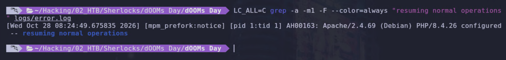

- **Buscar la cabecera `X-Powered-By`.** PHP la envía con su versión en cada respuesta, y aparece en el log porque `mod_dumpio` también vuelca las respuestas del servidor. Usa `-E` con `[0-9.]+` para capturar la versión sin conocerla de antemano, y `-m5` para ver varias respuestas y comprobar que todas coinciden.

```bash
LC_ALL=C grep -a -m5 -E --color=always "X-Powered-By: PHP/[0-9.]+" logs/error.log
```

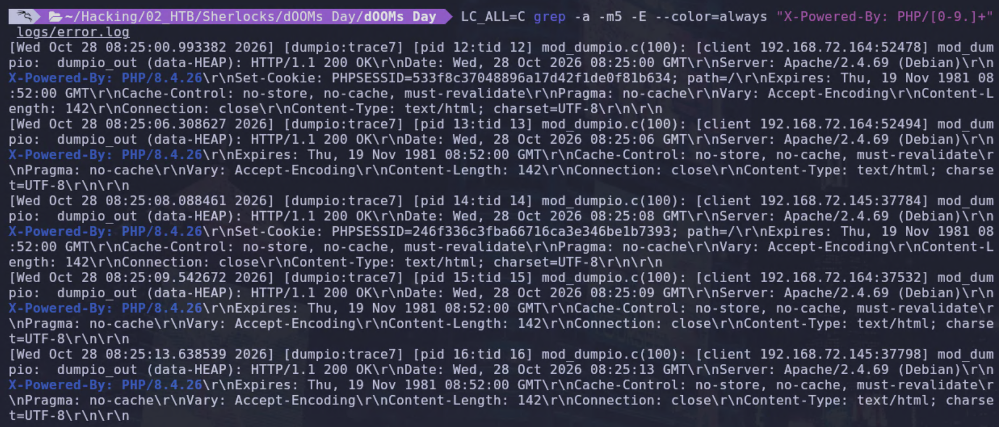

En `Capture.pcap`:

- **Buscar la misma cabecera en las respuestas HTTP.** `-Y http.response` muestra solo las respuestas, `-T fields -e http.response.line` imprime solo las cabeceras y `tr` las separa una por línea para que `grep` pueda filtrarlas. En Wireshark, el filtro equivalente es `http.response.line contains "X-Powered-By"`.

```bash
tshark -r Capture.pcap -Y 'http.response' -T fields -e http.response.line | tr '\r' '\n' | grep -a -m5 --color=always "X-Powered-By"
```

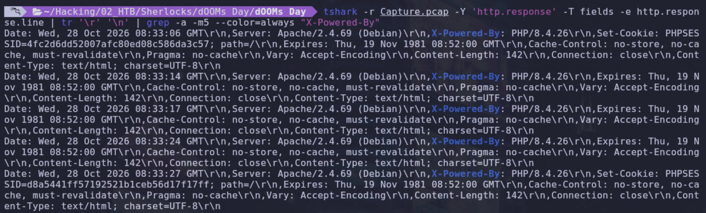

`Apache/2.4.69 (Debian) PHP/8.4.26` aparece en el `notice` de las 08:24:49, y `X-Powered-By: PHP/8.4.26` está clavada en las respuestas del `error.log` y del `.pcap`. La `8.4.26` es la última de la rama 8.4 sin el parche de PHP2Shell, que es como se conocen [CVE-2026-109618](https://nvd.nist.gov/vuln/detail/CVE-2026-109618) (corrupción de memoria por mala gestión del out-of-memory, [advisory de PHP](https://github.com/php/php-src/security/advisories/GHSA-w8hw-w9fx-j79w)) y [CVE-2026-109619](https://nvd.nist.gov/vuln/detail/CVE-2026-109619) (estado global obsoleto en `session.upload_progress`, [advisory de PHP](https://github.com/php/php-src/security/advisories/GHSA-6wmf-4rv5-p3rp)), que se corrigieron en `8.4.27` el 21 de octubre de 2026, justo una semana antes del incidente. Y, por si fuera poco, está corriendo `mod_php` sobre `mpm_prefork`, que es la combinación con más papeletas de todas.

**Respuesta:** `8.4.26`

## Tarea 2

> *At what exact date and time did the attacker send the first request belonging to the exploitation attempt? Provide the timestamp of the earliest anomalous request from the attacker's IP address in the web server logs.*

El enunciado me limita a los logs del servidor web, así que miro el `access.log`, que es pequeño y se puede leer entero sin problema. De momento no toco el `.pcap` ni los 500 MB del `error.log`.

La explotación de **PHP2Shell** la lanza una herramienta que hace `POST` a endpoints que no esperan subidas, y esas herramientas no suelen traer `User-Agent`. Un conteo de IPs cruzado con la última palabra del `User-Agent` separa al atacante del resto sin complicaciones.

```bash
awk -F'"' '{print $1, $6}' logs/access.log | awk '{print $1, $NF}' | sort | uniq -c | sort -rn
```

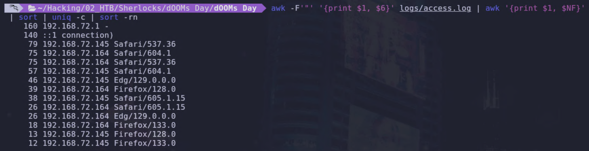

`192.168.72.1` lanza 160 peticiones con `User-Agent -`, que es lo que Apache guarda cuando el cliente no envía la cabecera. Ningún navegador hace eso; sí lo hace `curl`, Python o algún exploit. `::1` es Apache hablándose a sí mismo, su `User-Agent` real es `(internal dummy connection)` y el `awk` solo deja la última palabra. Son los `OPTIONS *` que prefork manda para despertar workers y los descarto. `192.168.72.145` y `192.168.72.164` usan `User-Agents` de navegadores variados (Safari, Edge, Firefox, Chrome); ese es el tráfico de relleno del laboratorio. El atacante es `192.168.72.1`.

Apache escribe cada línea del `access.log` cuando la petición termina, no al empezar. Con peticiones concurrentes de distinta duración el fichero queda desordenado y la primera línea de una IP no tiene por qué ser su primera petición, así que ordeno por el campo del timestamp y me quedo con la más temprana.

```bash
grep '^192.168.72.1 ' logs/access.log | sort -k4 | head -3
```


28 de octubre de 2026, 08:42:52 UTC. `POST /index.php`, `200` y `0 bytes` de respuesta. En ese mismo segundo llegaron varias idénticas. Nadie las hace a mano; es una herramienta disparando en paralelo contra un endpoint que no espera subidas.


El `error.log` con `mod_dumpio` muestra la hora de llegada real con microsegundos. Busca la primera aparición de la IP con `grep -a -m1 "client 192.168.72.1:"`. No es estrictamente necesario, pero si el segundo no coincide con el del `access.log`, me gustaría saber por qué.


**Respuesta:** `2026-10-28 08:42:52`

## Tarea 3

> *To occupy the worker pool, the exploit sent stalled multipart uploads. What is the value of the boundary separator used in these requests?*

Lo de las subidas multipart estancadas del enunciado es la tanda de `POST /index.php` que vi en la tarea 2; ya me olía que tenía que ser eso. Decenas de peticiones en el mismo segundo, todas con `0 bytes` de respuesta y ninguna con User-Agent. El servidor nunca llegó a tener nada que contestar porque los cuerpos no terminaban de entrar. Todas esas peticiones llevan `Content-Type: multipart/form-data` con un `boundary`, y si la herramienta es la misma el separador también lo será. Como el `access.log` no guarda cabeceras de petición, miro el `error.log`, que con `mod_dumpio` lo tiene todo.

Antes de nada quiero la cifra con la que voy a contrastar todo lo que venga después, así que cuento la tanda en el `access.log`.

```bash
grep -c '^192.168.72.1 .*POST /index.php' logs/access.log
```


Salen 149, y el `MaxRequestWorkers` que trae el paquete `apache2` de Debian es 150. Es todo el pool menos uno, el hueco que se deja libre a propósito para lo que venga después. Ese 150 lo saco de la configuración por defecto de Debian, así que lo apunto como supuesto hasta que algo en los artefactos me lo confirme.

Con esa cifra en la mano cuento todas las cabeceras multipart que manda el atacante. Si el exploit va por fases, cada una tendrá su separador, y el que aparezca 149 veces será el mío.

```bash
LC_ALL=C grep -a -F "client 192.168.72.1:" logs/error.log | LC_ALL=C grep -a -oE "boundary=[^\\]+" | sort | uniq -c | sort -rn
```

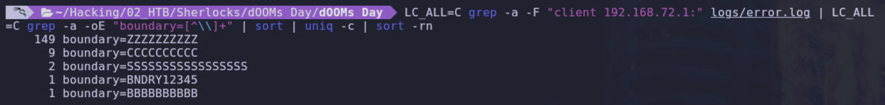

El separador `ZZZZZZZZZZ` clava el número. Alguien se ha esmerado mucho eligiendo el nombre. Los otros cuatro valores aparecen nueve, dos, una y una vez; son cosas distintas del mismo atacante que me iré encontrando.

Con el recuento me vale, pero quiero verlo dentro de una petición. `mod_dumpio` marca cada línea con `[client IP:puerto]`, así que cojo el puerto de una conexión de la tanda y miro cómo empieza.

```bash
LC_ALL=C grep -a -F "client 192.168.72.1:54322]" logs/error.log | LC_ALL=C grep -a "dumpio_in (data-HEAP):" | head -8
```

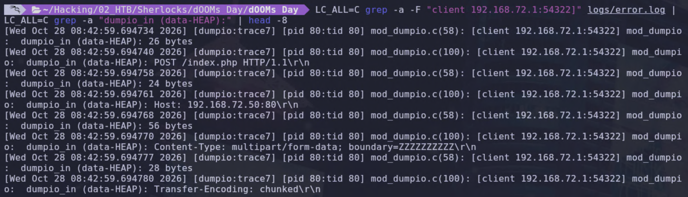

La conexión `54322` llega a las 08:42:59 con `POST /index.php`, `Content-Type: multipart/form-data; boundary=ZZZZZZZZZZ` y `Transfer-Encoding: chunked`. Ahí está todo lo que hacía falta ver, y el separador es el mismo que me daba el recuento.

**Respuesta:** `ZZZZZZZZZZ`

## Tarea 4

> *The exploit deliberately occupied the Apache worker pool with stalled multipart uploads, forcing the exploit's requests to land on the same single worker so that memory is leaked from the same process heap. How many workers did the exploit deliberately occupy?*

Esta ya la tengo prácticamente de la tarea 3, y de paso el enunciado me confirma lo que ahí dejé como supuesto: que el pool era de 150 y el exploit lo llenó dejando un único hueco para que todas sus peticiones cayeran en el mismo proceso. Las subidas estancadas eran la tanda de `POST /index.php` y salían 149 en el `access.log`.

Como no me suelo fiar de un solo artefacto, lo cuento también en el `error.log`, pero por conexiones y no por líneas. Cada subida estancada lleva el `boundary=ZZZZZZZZZZ`, así que saco los puertos de origen de las líneas que lo contienen y cuento cuántos distintos hay.

```bash
LC_ALL=C grep -a -F "boundary=ZZZZZZZZZZ" logs/error.log | LC_ALL=C grep -a -oE "client 192.168.72.1:[0-9]+" | sort -u | wc -l
```

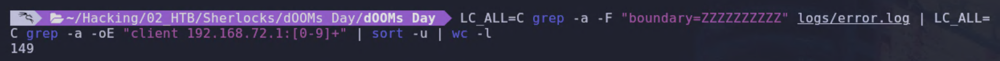

Siguen saliendo 149 conexiones distintas, una por **worker** ocupado. Con 150 procesos en el pool queda justo uno libre, y ahí es donde el exploit quería que cayera todo lo demás.

**Respuesta:** `149`

## Tarea 5

> *Which two CVEs are chained together to achieve remote code execution?*

Salvo que hayas vivido debajo de una piedra estas últimas semanas, esto no hace falta ni mirarlo en el log. PHP `8.4.26` con `mod_php` y un atacante mandando multipart raros a un endpoint que no espera subidas, dejando las subidas atascadas y ocupando el pool para que todo caiga en el mismo proceso, es un caso claro de PHP2Shell. Son [CVE-2026-109618](https://nvd.nist.gov/vuln/detail/CVE-2026-109618), corrupción de memoria por mala gestión del out-of-memory, y [CVE-2026-109619](https://nvd.nist.gov/vuln/detail/CVE-2026-109619), el estado obsoleto en `session.upload_progress`. PHP las parcheó juntas el 21 de octubre y desde entonces no se habla de otra cosa, así que el que montó este laboratorio no se complicó mucho al elegir tema.

Si te has perdido el culebrón, cada una deja su propia marca en el `error.log`. La 109618 aparece al agotar la memoria de PHP durante el inicio de la petición, y PHP la registra como un fatal error `Allowed memory size ... exhausted` que acaba en `in Unknown on line 0`, que es lo que pasa cuando el error ocurre antes de que exista un script. La 109619 está en `session.upload_progress`, y para activarla el multipart debe llevar un campo llamado `PHP_SESSION_UPLOAD_PROGRESS`. Quiero ver las dos huellas en una sola pasada y por la misma conexión, para comprobar si van juntas o salen por separado.

```bash
LC_ALL=C grep -a -F "client 192.168.72.1:" logs/error.log | LC_ALL=C awk 'match($0,/client 192\.168\.72\.1:[0-9]+/){p=substr($0,RSTART+20,RLENGTH-20)} /Allowed memory size/{print p, "OOM  CVE-2026-109618"} /PHP_SESSION_UPLOAD_PROGRESS/{print p, "upload_progress  CVE-2026-109619"}' | sort | uniq -c | sort -k2n
```

El primer `grep` selecciona las líneas del atacante. El `awk` usa `match` para sacar el puerto de origen de la etiqueta `[client IP:puerto]`, lo guarda en `p` y lo imprime con una etiqueta según lo que diga la línea: `OOM` para el error fatal de memoria o `upload_progress` para el campo de sesión. `sort | uniq -c` agrupa y cuenta, y el `sort -k2n` final ordena por puerto para leerlo como una cronología de conexiones.

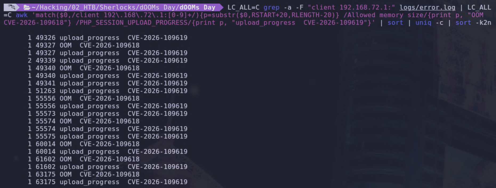

Son 13 las conexiones que llevan el campo `PHP_SESSION_UPLOAD_PROGRESS` (14 líneas, la `49339` lo repite), 7 de ellas acaban en fatal error de memoria, y ninguna tiene el OOM sin el campo de sesión. Las dos huellas van siempre juntas en la misma petición, que es exactamente lo que significa “chained” en el enunciado. El pool lleno de la tarea 4 es lo que hace que todas caigan en el mismo proceso.

**Respuesta:** `CVE-2026-109618, CVE-2026-109619`

## Tarea 6

> *The exploit used the Out of Memory (OOM) primitive during exploitation. What was the PHP memory limit, in bytes, that the exploit exhausted to trigger the out-of-memory vulnerability?*

Esta pregunta me la da el mismo fatal error de la tarea anterior, porque cuando PHP supera el `memory_limit` lo pone con el número delante: `Allowed memory size of N bytes exhausted`. Extraigo solo esa parte de las siete líneas del atacante y compruebo que todas digan lo mismo. Si el límite hubiera cambiado en mitad del ataque, habría algo raro que explicar.

```bash
LC_ALL=C grep -a -F "client 192.168.72.1:" logs/error.log | LC_ALL=C grep -a -oE "Allowed memory size of [0-9]+ bytes" | sort | uniq -c
```

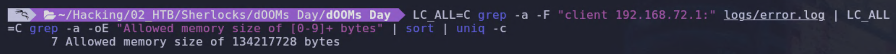

Un total de 7 veces sale `134217728`, que son 128 MiB, el `memory_limit` que trae el `php.ini-production` de serie y el que recomienda bajar o subir todo el mundo desde que salió **PHP2Shell**. Nadie lo había tocado en este servidor.

**Respuesta:** `134217728`

## Tarea 7

> *The exploit leaks heap memory from the server to retrieve a heap address value, which is then used to facilitate the remote code execution process. What is the name of the cookie through which this leaked data is delivered to the attacker?*

Una respuesta con **heap** dentro pesa, y la de `774455 bytes` de las 08:43:01 ya la tenía fichada en el `access.log`. Era un `POST` a `/api/health.php` que otras veces viene con un **JSON** de `15 bytes`. Si va en una cookie, como dice el enunciado, es una cabecera `Set-Cookie`. Con `tshark` busco todas las que el servidor le ha puesto a `192.168.72.1`, con la longitud al lado y el valor recortado a 50 caracteres, que ya me imagino lo que viene. El `2>/dev/null` es porque el **disector** `MIME multipart` protesta en cada `POST` de este tío. Ojo con la hora: `frame.time` sale en la hora local de mi máquina, UTC-4, así que a lo que marque hay que sumarle cuatro horas para cuadrarlo con los logs.

```bash
tshark -r Capture.pcap -Y 'http.set_cookie && ip.dst==192.168.72.1' -T fields -e frame.number -e frame.time -e tcp.stream -e http.set_cookie 2>/dev/null | awk -F'\t' '{print $1, $2, "stream", $3, "longitud", length($4), substr($4,1,50)}'
```

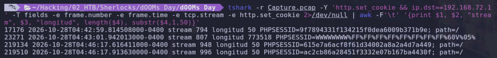

Salen 4 cookies, tres de ellas sesiones normales de PHP, 32 hexadecimales más `path=/`. Una de ellas, `stream 807` a las 08:43:01.942 UTC, mide `773518` y arranca con `WWWWWWWW%FF%FF%FF...`, bytes crudos escapados en porcentaje donde este servidor solo reparte hexadecimales. Casi 3/4 de mega pesa la cookie, y PHP tan tranquilo. Es el **heap** del proceso saliendo por la cabecera de sesión de toda la vida, y al atacante le bastó con leer la respuesta como haría cualquier navegador.


Si se quiere hacer con Wireshark, el mismo filtro y Follow TCP Stream sobre el `807` para ver el chorro entero, por si tienes curiosidad de cómo lucen `770 KB` de memoria metidos en una cookie.


**Respuesta:** `PHPSESSID`

## Tarea 8

> *What is the size of this leaked cookie according to the logs?*

De los 3 logs, el único que muestra tamaños es el `error.log`. `mod_dumpio` con `trace7` copia todo lo que sale por cada conexión en trozos. Para cada trozo escribe cuántos bytes trae y luego el contenido. Si la cookie salió por ahí, el número ya aparece. Busco un `dumpio_out` de seis cifras o más, porque lo normal cabe en unas decenas de bytes. El `cut` a 200 caracteres va primero para que `grep` no se trague el valor entero, uso `-a` para que no lo trate como binario y `-B4 -A1` para ver de qué cabecera cuelga el trozo.

```bash
cut -c1-200 logs/error.log | grep -a -n --color=always -B4 -A1 "dumpio_out (data-HEAP): [0-9]\{6,\} bytes"
```

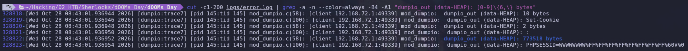

En la línea `328822` aparece `773518 bytes` y la siguiente empieza con `PHPSESSID=WWWWWWWW%FF...`, la cookie de la tarea 7, en la conexión `49339` que en la tarea 5 repetía el campo `PHP_SESSION_UPLOAD_PROGRESS`. Las cuatro líneas de arriba muestran cómo Apache escribe una cabecera en partes: diez bytes para `Set-Cookie`, dos para el separador y luego el valor entero de golpe, desde `PHPSESSID=` hasta el `path=/`. Por eso el número coincide con el `length()` del `awk` de la tarea anterior; medían la misma cadena. Y el administrador que dejó `trace7` en producción ahora tiene una copia de la memoria filtrada en su propio `error.log`. Para mí, como forense, un regalo, pero alguien se ha metido en un problema.

Lo que no me cuadra a la primera son los `774455` del `access.log` para esa misma respuesta, `937 bytes` más. Con el `combined` de Debian ese campo es `%O`, todo lo que salió por el socket, y lo compruebo sumando el `tcp.len` de cada segmento del servidor en el **stream** `807`, que es la carga útil sin lo que añaden TCP e IP. Si el campo es lo que digo, la suma tiene que clavar la cifra del log.

```bash
tshark -r Capture.pcap -Y 'tcp.stream==807 && ip.src==192.168.72.50' -T fields -e tcp.len 2>/dev/null | awk '{s+=$1} END{print s}'
```

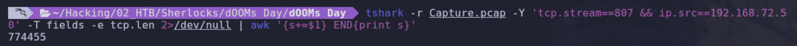

La suma da `774455` clavaditos. Ese campo cuenta todo lo que Apache metió en el socket y le da igual si era cuerpo, cabeceras o una cookie de tres cuartos de mega. Los `937 bytes` de diferencia son la línea de estado, el resto de cabeceras con sus saltos de línea y el cuerpo. La cifra que pide el enunciado es la de la cookie sola, la que `mod_dumpio` dejó apuntada antes de volcarla.

**Respuesta:** `773518`

## Tarea 9

> *When did the attacker achieve remote code execution capability?*

La prueba más clara de que en el servidor ya está corriendo código del atacante es verlo abrir él mismo una conexión hacia `192.168.72.1`. En el `.pcap` eso se ve como un `SYN` sin `ACK` que sale de `192.168.72.50`. Le pido a `tshark` justo esos segmentos, con el **stream** y los puertos, para saber dónde seguir mirando. La hora la saco con `frame.time_utc` en vez de `frame.time`, porque ese campo siempre aparece en la hora local de la máquina y la mía está en UTC-4; ya me hizo perder tiempo usar el `-t ud`.

```bash
tshark -r Capture.pcap -Y 'ip.src==192.168.72.50 && ip.dst==192.168.72.1 && tcp.flags.syn==1 && tcp.flags.ack==0' -T fields -e frame.number -e frame.time_utc -e tcp.stream -e tcp.srcport -e tcp.dstport 2>/dev/null
```

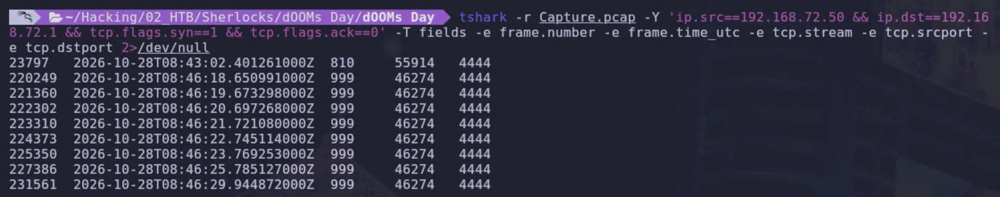

La primera tanda es un solo `SYN` a las 08:43:02.401 UTC, del puerto `55914` del servidor al `4444` del atacante, **stream** `810`. Un `SYN` es el «hola» con el que se abre una conexión TCP, y aquí lo dice el servidor. Apache lleva toda la mañana contestando sin llamar a nadie y medio segundo después de escupir tres cuartos de mega de **heap** marca el número del atacante. Un servidor web no saluda a los clientes; si lo hace es porque el código que el atacante le ha metido dentro se lo ha ordenado.

Si el destino no responde a un `SYN`, el kernel del servidor lo reenvía con esperas cada vez más largas, y aquí no lo reenvía: el atacante tenía el `4444` abierto y contestó a la primera. La segunda tanda son ocho `SYN` desde el `46274` entre las 08:46:18 y las 08:46:29, con esperas de uno, uno, uno, uno, uno, dos y cuatro segundos. El servidor llamando a una puerta que el atacante ya no abre. Había recogido el oyente; con la primera sesión le sobró. Y todo al `4444`, el puerto del primer tutorial de reverse shell que sale en Google. Tanto **heap**, tanto CVE encadenado, y el puerto lo deja de fábrica.

El `.1` de una `192.168.72.0/24` es lo que VMware le pone al host en sus redes NAT, así que lo más probable es que el ataque salga de la máquina que aloja al servidor. Es un supuesto; el `.pcap` no lo dice. Para la pregunta vale la primera llamada, y antes de darla por buena miro los tres primeros paquetes del **stream** `810`, que tienen que ser saludo, respuesta y confirmación. `_ws.col.Info` es la columna Info de Wireshark entera y el `awk` se queda con lo que va entre corchetes, los flags, que `Seq`, `Win` y `MSS` aquí no pintan nada.

```bash
tshark -r Capture.pcap -Y 'tcp.stream==810' -T fields -e frame.time_utc -e ip.src -e tcp.srcport -e ip.dst -e tcp.dstport -e _ws.col.Info 2>/dev/null | head -3 | awk -F'\t' '{match($6,/\[[^]]*\]/); print $1, $2":"$3, "->", $4":"$5, substr($6,RSTART,RLENGTH)}'
```

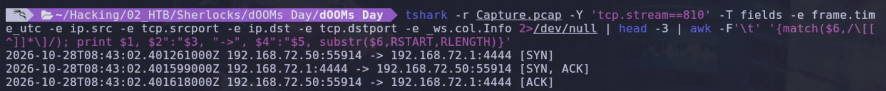

El **handshake** completo en cuatro décimas de milisegundo, lo que tarda un paquete en cruzar la LAN. Sale el `[SYN]` del servidor a las 08:43:02.401261, vuelve el `[SYN, ACK]` del `4444` y el servidor remata con el `[ACK]`. Conexión abierta y recogida. Desde este punto, la máquina es enterita del atacante, y en el `access.log` sigue saliendo un `200` en `/api/health.php`. Todo sano, según el log.

**Respuesta:** `2026-10-28 08:43:02`

## Tarea 10

> *What port was used for the remote code execution shell?*

Ya lo tengo de la tarea 9. Las dos tandas de `SYN` que salen del servidor van al `4444` del atacante: la primera con el **handshake** completo y la segunda llamando al vacío. Para no asumir que el atacante no abrió otra puerta, cuento todos los `SYN` que ha mandado `192.168.72.50` a cualquier destino, agrupados por dirección y puerto, sin filtrar por el atacante.

```bash
tshark -r Capture.pcap -Y 'ip.src==192.168.72.50 && tcp.flags.syn==1 && tcp.flags.ack==0' -T fields -e ip.dst -e tcp.dstport 2>/dev/null | sort | uniq -c
```

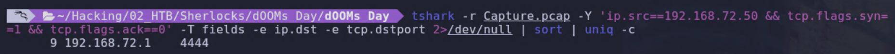

Joder, 9 `SYN` en toda la captura, todos a `192.168.72.1` y todos al `4444`, el de la conexión buena y los 8 reintentos de cuando el atacante ya había apagado el listener. El servidor no ha hablado con nadie más en todo el `.pcap`. Un solo puerto y el de fábrica, para no complicarse demasiado.

**Respuesta:** `4444`

## Tarea 11

> *When did the exploit cause a second crash of an Apache worker process?*

Con `mpm_prefork` cada petición la atiende un proceso hijo. Cuando uno falla, el padre (que en este contenedor es el `pid 1`) lo registra en el `error.log` como un `notice` con el código `AH00052`, el pid del hijo y la señal que lo mató. Un exploit que corrompe memoria y falla deja justo esa marca: un `Segmentation fault (11)` con el nombre del proceso que se corrompió. Busco ese código en el `error.log` y la línea, que luego me servirá para ver qué estaba haciendo ese hijo justo antes de morir.

```bash
LC_ALL=C grep -a -n --color=always "AH00052" logs/error.log
```

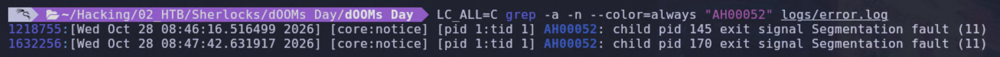

Salieron dos hijos muertos por `Segmentation fault`, el `pid 145` a las 08:46:16.516 y el `pid 170` a las 08:47:42.631. Ambos estaban gestionados por el padre con el `AH00052`. El `145` ya era conocido: en la tarea 8 era el proceso que escribía la cookie de `773518 bytes` por la conexión `49339`. Era el que llevaba todo el trabajo del atacante desde las 08:43. Aguantó más de tres minutos con el **heap** destrozado y cayó a las 08:46:16, justo un segundo antes de una tanda de `POST` a `/api/health.php` a las 08:46:17 que aparece en el `access.log`.

El `pid 170` fue el relevo: el hijo que `prefork` levantó para seguir atendiendo cuando cayó el `145`, y se llevó la segunda ronda del atacante desde las 08:46:17. Duró minuto y medio. A las 08:47:42.631 reventó igual, y en el `access.log` el último `POST` del atacante a `/api/health.php` es de las 08:47:43, la petición que lo remata. Dos procesos muertos con la misma señal en noventa segundos, y Apache levantando uno nuevo cada vez sin protestar, que para eso está `prefork`.

**Respuesta:** `2026-10-28 08:47:42`

## Tarea 12

> *What is the command executed to find database files on the compromised server?*

El atacante escribe 6 veces en toda la sesión, con casi un minuto entre una línea y la siguiente, al ritmo de alguien tecleando a mano y leyendo cada respuesta antes de seguir. Abre a las 08:43:36 con `cat /proc/version` y a las 08:44:30 repite con `uname -a`, dos comandos que cuentan casi lo mismo del kernel, por si el primero fallaba. A las 08:44:42 lanza `ps aux` para ver qué más corre en la máquina. Tres minutos de reconocimiento superficial antes de ir a por lo que realmente le interesa.

```bash
tshark -r Capture.pcap -Y 'tcp.stream==810 && ip.src==192.168.72.1 && tcp.len>0' -T fields -e frame.time_utc -e data.text -o data.show_as_text:TRUE 2>/dev/null
```

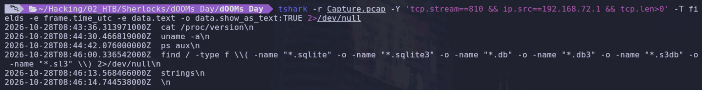

Esto se llama “Crónica de una muerte anunciada”:

- A las 08:46:00 llega el bueno, un `find /` que recorre el sistema de ficheros entero buscando ficheros regulares, `-type f`, con cualquiera de las seis extensiones que suele llevar una base de datos **SQLite**, `.sqlite`, `.sqlite3`, `.db`, `.db3`, `.s3db` y `.sl3`. Los paréntesis escapados agrupan los `-name` unidos con `-o`, el «o» lógico de `find`, para que el `-type f` valga para todos. El `2>/dev/null` del final se traga los `Permission denied` que suelta `find` cada vez que se topa con un directorio que el usuario de Apache no puede leer. Claramente va a por SQLite y a por nada más, ni MySQL ni PostgreSQL. No sé si lo leyó, pero el propio blog tiene publicado un post en `/post/sqlite-wal` que aparecía en el `access.log`, así que la pista de qué motor usa la tenía a un `GET` de distancia.
- A las 08:46:13 escribe `strings` a secas, sin fichero detrás, y un segundo después un intro vacío. `strings` sin argumento se pone a leer de la entrada estándar, y el pobre se queda ahí esperando datos que no llegan.
- Dos segundos más tarde, a las 08:46:16, revienta el `pid 145` de la tarea 11, el proceso que sostenía la shell, y en el `stream 810` el atacante ya no vuelve a escribir.

Una cadena de dos CVE para acabar la sesión con un `strings` colgado.

**Respuesta:** `find / -type f \( -name "*.sqlite" -o -name "*.sqlite3" -o -name "*.db" -o -name "*.db3" -o -name "*.s3db" -o -name "*.sl3" \) 2>/dev/null`
